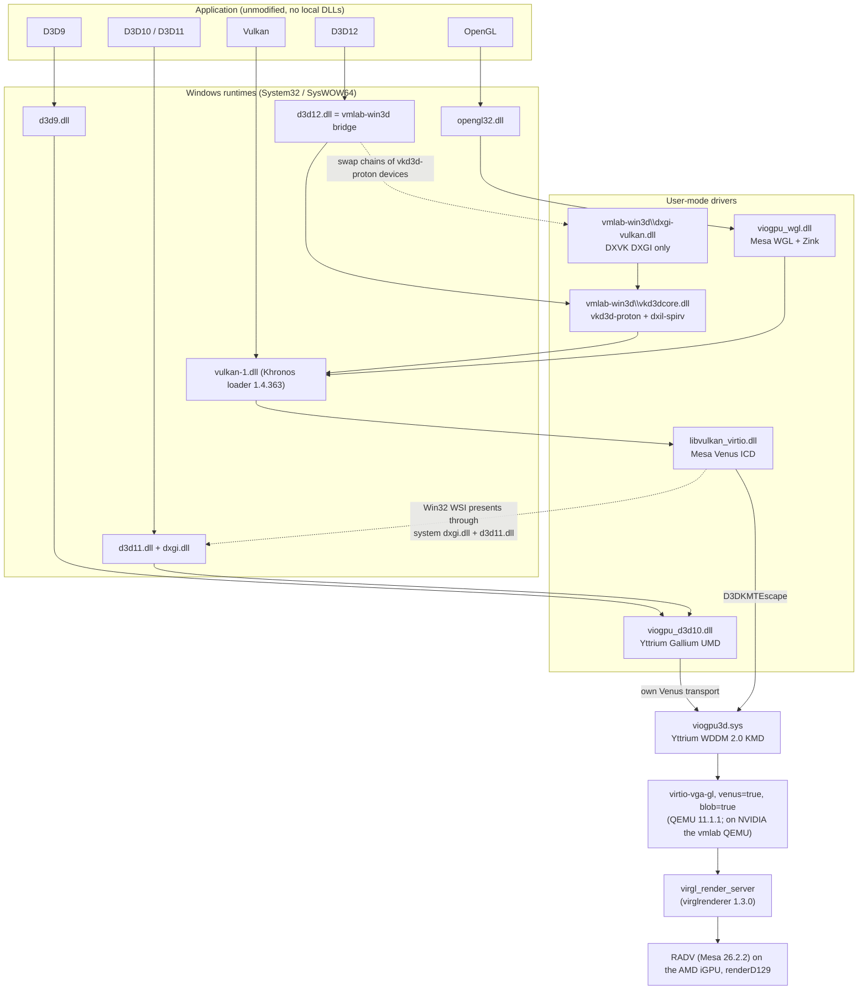

# Component stack

This page describes every layer between a Windows application in the guest
and the GPU in the host. For each component it lists the files installed in
the guest, how Windows finds them, the upstream source and pin, this
repository's patches, and the licence. The pin and patch tables at the end
are generated from `build/*/PINS` and `patches/` by `scripts/pins-table.py`.

## The path of a frame

Nothing in the guest talks to the GPU directly. Every API ends up as Vulkan
commands that the Venus protocol carries over virtio-gpu to the host. There,
virglrenderer replays them on the host's Vulkan driver. The diagram shows the
reference host, helios, where that driver is RADV on an AMD iGPU.
[Tested hosts](#tested-hosts) lists the other host GPUs.

Read the diagram with these points in mind:

- **D3D9, D3D10 and D3D11 do not go through Vulkan in the guest.** The
  Yttrium UMD translates shaders to SPIR-V and encodes Venus commands itself.
  It does not load `libvulkan_virtio.dll` or `vulkan-1.dll` (prior-art §1).
- **D3D12 is the only API that needs a system file replaced.** Windows has no
  supported way to register a third-party D3D12 implementation except a
  native D3D12 UMD, which no component here provides. The installer replaces
  `d3d12.dll` with a bridge that loads vkd3d-proton (see
  [Known limits](known-limits.md)).
- **Every Vulkan-based frame is presented through the D3D11 UMD.** Mesa's
  Win32 WSI creates a D3D11 device on the system `dxgi.dll` and `d3d11.dll`
  and copies each image into a composition swap chain. That is why the
  package never replaces `dxgi.dll` or `d3d11.dll`; when the prior art did,
  even vkcube hung (prior-art §3, §4.5).
- **The host side is not built here.** QEMU, virglrenderer and RADV are the
  host's Arch packages (`docs/host.md`). Decision D3 in `docs/plan.md` keeps
  them at the versions shown. The exception is NVIDIA hosts, which need a
  patched QEMU (`patches/host/`, [Host patches](#host-patches)).

The probes confirm which modules each API loads in the guest:
`docs/evidence/package/03-probes-summary.json`, `graphics_modules`.

## Layers

Paths are for a default Windows directory. "x64" files go to
`C:\Windows\System32`, "x86" files to `C:\Windows\SysWOW64`. The class key is
the display adapter's
`HKLM\SYSTEM\CurrentControlSet\Control\Class\{4d36e968-e325-11ce-bfc1-08002be10318}\<nnnn>`.

### Windows runtimes

| | |
| --- | --- |
| Guest files | `d3d9.dll`, `d3d11.dll`, `dxgi.dll`, `opengl32.dll`, `D3D12Core.dll` |
| Found by | They ship with Windows. The package leaves all of them in place. |
| Upstream | Microsoft |

The D3D9 and D3D11 runtimes read `UserModeDriverName[Wow]` from the class key
and load the UMD named there. `opengl32.dll` reads `OpenGLDriverName[Wow]`
and loads the WGL ICD. The package changes only `d3d12.dll`, described below.

### Vulkan loader

| | |
| --- | --- |
| Guest files | x64 and x86: `vulkan-1.dll`, `vulkaninfo.exe` |
| Found by | Applications import `vulkan-1.dll` from System32/SysWOW64. The loader finds ICDs through `HKLM\SOFTWARE\Khronos\Vulkan\Drivers` (and `WOW6432Node`). |
| Installed by | `installer/vmlab-win3d.ps1`, only when the existing `vulkan-1.dll` is missing or has an older file version. The template has 1.3.300. |
| Upstream | [KhronosGroup/Vulkan-Loader](https://github.com/KhronosGroup/Vulkan-Loader) and [Vulkan-Tools](https://github.com/KhronosGroup/Vulkan-Tools), tag `vulkan-sdk-1.4.363.0` |
| Build | [`build/vulkan-sdk/`](../build/vulkan-sdk/README.md) |
| Patches | Loader: none. Vulkan-Tools: 1, `vulkan-tools/0001`, which stops the llvm-mingw `vulkaninfo.exe` crashing on a null `user32_handles` (table below) |
| Licence | Apache-2.0 |

### D3D12: the bridge, vkd3d-proton and DXVK's DXGI

| | |
| --- | --- |
| Guest files | x64 and x86: `d3d12.dll` (the bridge), `vmlab-win3d\vkd3dcore.dll`, `vmlab-win3d\dxgi-vulkan.dll`, and `vmlab-win3d\d3d12-native.dll`, which is the machine's own `d3d12.dll` copied at install time |
| Found by | Applications load `d3d12.dll` from System32/SysWOW64 as usual. The bridge finds `vmlab-win3d\` next to its own file, with no registry or environment lookup. |
| Installed by | The installer: takes ownership of `d3d12.dll`, replaces it, and restores the TrustedInstaller owner and ACL. The `vmlab-win3d-repair` startup task puts the bridge back after Windows servicing. |
| Upstream | [vkd3d-proton](https://github.com/HansKristian-Work/vkd3d-proton) v3.0.1, [dxil-spirv](https://github.com/HansKristian-Work/dxil-spirv) at `8434b063` (newer than vkd3d-proton's gitlink), [DXVK](https://github.com/doitsujin/dxvk) v3.1.1 built with only DXGI |
| Build | [`build/d3d12/`](../build/d3d12/README.md) |
| Patches | vkd3d-proton 5, DXVK 1, dxil-spirv 0 (table below). `vkd3d-proton/0005` turns vkd3d-proton's `d3d12.dll` into the system-wide bridge. |
| Licence | vkd3d-proton LGPL-2.1-or-later; dxil-spirv MIT; DXVK zlib |

The bridge implements the D3D12 entry points with vkd3d-proton and forwards
every other export to `d3d12-native.dll`. It hooks the four
`CreateSwapChain*` methods of the native DXGI factory, so swap chains on
vkd3d-proton queues go to DXVK's DXGI, and everything else stays native.
`build/d3d12/README.md` explains the export table and the hooks.

### D3D9, D3D10 and D3D11: the Yttrium UMD

| | |
| --- | --- |
| Guest files | x64 and x86: `viogpu_d3d10.dll` |
| Found by | Class key `UserModeDriverName` = `C:\Windows\System32\viogpu_d3d10.dll` three times (D3D9, D3D10, D3D11), `UserModeDriverNameWow` = the SysWOW64 path three times, `InstalledDisplayDrivers` = `viogpu_d3d10` three times. There is no D3D12 entry. |
| Installed by | The INF (`VioGpu3D_Files.Usermode`, `VioGpu3D_Files.Wow64`, `VioGpu3D_DeviceSettings`) |
| Upstream | [arehnman/virtio-win-mesa](https://github.com/arehnman/virtio-win-mesa), branch `yttrium-experimental`, commit `374c3022` (Mesa 26.1.0) |
| Build | [`build/mesa/`](../build/mesa/README.md) |
| Patches | Mesa 19, shared with the two Mesa components below (table below). 0005 to 0010, 0012 to 0017, 0020 and 0021 change this UMD; 0001 to 0003 are shared build and utility fixes. |
| Licence | Mesa MIT; the Yttrium winsys (`src/gallium/winsys/yttrium/gdi/`) MPL-2.0 |

`viogpu_d3d10.dll` is Mesa's `d3d10umd` front end (D3D10/11 DDI, plus a
D3D9 DDI) on the Yttrium Gallium driver. It talks to the KMD through its own
embedded Venus transport.

### OpenGL: Mesa WGL with Zink

| | |
| --- | --- |
| Guest files | x64 and x86: `viogpu_wgl.dll` |
| Found by | Class key `OpenGLDriverName` and `OpenGLDriverNameWow` = `viogpu_wgl.dll` in System32 and SysWOW64, `OpenGLFlags[Wow]` = 3, `OpenGLVersion[Wow]` = 4096 |
| Installed by | The INF. The package does not replace `opengl32.dll`, unlike Yttrium's release INF. |
| Upstream | Same Mesa tree as above |
| Patches | Mesa 0002 to 0004 |
| Licence | MIT |

Zink turns OpenGL into Vulkan and runs on the Venus ICD through
`vulkan-1.dll`. The probe reports the renderer as
`zink Vulkan 1.4 (Virtio-GPU Venus (… RADV RAPHAEL_MENDOCINO))`.

### Vulkan: the Mesa Venus ICD

| | |
| --- | --- |
| Guest files | x64: `libvulkan_virtio.dll`, `virtio_icd.x86_64.json`; x86: `libvulkan_virtio.dll`, `virtio_icd.x86.json` |
| Found by | `HKLM\SOFTWARE\Khronos\Vulkan\Drivers` value `C:\Windows\System32\virtio_icd.x86_64.json` = 0, and `HKLM\SOFTWARE\WOW6432Node\Khronos\Vulkan\Drivers` value `C:\Windows\SysWOW64\virtio_icd.x86.json` = 0. Each manifest names `.\libvulkan_virtio.dll`, relative to itself, with `api_version` 1.4.348. |
| Installed by | The INF (`VioGpu3D_Files.Vulkan`, `VioGpu3D_Files.VulkanWow64`) |
| Upstream | Same Mesa tree, `src/virtio/vulkan` |
| Patches | Mesa 0001 (build) and 0011 (Win32 NT-handle memory) |
| Licence | MIT; `vn_renderer_d3dkmt.c` MPL-2.0 |

The ICD reports itself as `Virtio-GPU Venus (<host GPU name>)`. Its Windows
renderer, `vn_renderer_d3dkmt.c`, submits Venus commands to the KMD with
`D3DKMTEscape`. The ICD therefore works only with the Yttrium KMD.

### Kernel: the Yttrium viogpu3d KMD

| | |
| --- | --- |
| Guest files | `viogpu3d.sys`, `vgpusrv.exe`, `viogpuap.exe` in the driver store (`C:\Windows\System32\DriverStore\FileRepository\viogpu3d.inf_amd64_<hash>\`, INF DIRID 13); the INF as `C:\Windows\INF\oem<NN>.inf` |
| Found by | PnP matches the INF's hardware ID `PCI\VEN_1AF4&DEV_1050&SUBSYS_11001AF4&REV_01`. The INF adds the kernel service `VioGpu3D` and the user service `vgpusrv` ("VioGpu Resolution Service"), which starts `viogpuap.exe` in each user session. |
| Installed by | The installer runs `pnputil /add-driver viogpu3d.inf /install`. The package is test-signed ([decision 0001](decisions/0001-signing.md)). |
| Upstream | [arehnman/yttrium-virtio-gpu](https://github.com/arehnman/yttrium-virtio-gpu), tag `yttrium-experimental-2026-09-27`, a fork of virtio-win/kvm-guest-drivers-windows |
| Build | [`build/kmd/`](../build/kmd/README.md), clang-cl and lld-link against the WDK NuGet packages |
| Patches | 1 (table below) |
| Licence | BSD-3-Clause; Yttrium's changes to `viogpu3d` are also MPL-2.0 where marked |

The device appears as "Hardsoft VirtIO GPU 3D controller", driver version
100.6.101.58100. It is a WDDM 2.0 display miniport with Venus and blob
resource support and a 60 Hz VidPN timer. It needs the
`VIRTIO_GPU_F_VIRGL` feature, so it fails to start on a plain `virtio-vga`.

### Device: virtio-gpu Venus in QEMU

| | |
| --- | --- |
| What | `virtio-vga-gl,venus=true,blob=true,hostmem=4G`, the only display adapter; `-display egl-headless` on the render node of the host GPU |
| Set by | vmlab 0.25 or later: `gpu { mode = "vulkan" host_gpu = "AMD1" }` (`labs/probe/vmlab.wcl`), with `AMD1` declared in the host config `~/.config/vmlab/config.wcl` as `gpu "AMD1" { address = "0000:72:00.0" }`. vmlab 0.24 took the address in the lab file, as `gpu.address`; the evidence from before 0.25 used that form |
| Upstream | QEMU 11.1.1 (Arch `qemu-full 11.1.1-1`), not built here. NVIDIA GPUs run the vmlab QEMU instead (Host patches, below) |

`docs/host.md` shows why each of these settings is required. It measured
them on vmlab 0.23, with `qemu_args`, before vmlab emitted them itself.

### Host: virglrenderer and RADV

| | |
| --- | --- |
| What | `/usr/lib/virgl_render_server` forks one `virgl-N-gpu_render` process per guest Venus context; each replays the commands on the host Vulkan driver |
| Selected by | vmlab sets `VK_LOADER_DRIVERS_SELECT` in QEMU's environment from the kernel driver of the host GPU that `gpu.host_gpu` names (`*radeon*` for `AMD1`), so the render workers open only `renderD129`. `vulkan_icd` on that GPU's host config block sets `VK_DRIVER_FILES` instead. |
| Upstream | virglrenderer 1.3.0 (Arch `1.3.0-2.1`), Mesa RADV 26.2.2 (Arch `vulkan-radeon 3:26.2.2-2`), not built here |

### Tested hosts

The package was run on four host GPUs. AMD (RADV) is the reference: the
acceptance runs in `docs/acceptance.md` used it. Intel (ANV) passes with
`patches/mesa/0021`. NVIDIA works only partly. The full matrix, with the
evidence for each row, is in
[Known limits: host GPU support](known-limits.md#host-gpu-support).

### Host patches

`patches/host/` is **not part of the guest package**. `scripts/build.sh`
does not build it, and the installer does not use it. It holds patches to
two host components and the scripts that build them into `out/host/`, for
labs that select them explicitly. Nothing is installed on the host
(decision D3). Its pins are the `host` rows of the pin table below.

| Path | What it is for |
| --- | --- |
| `patches/host/build-qemu.sh`, `patches/host/bump-qemu.sh` and the `qemu` pin in `patches/host/PINS` | The vmlab QEMU: upstream QEMU master (11.1.50 at `a19f59a72d`, which has the shutdown-crash fix `baca25172d`) plus the series on the [VMLabDev/qemu](https://github.com/VMLabDev/qemu/tree/vmlab/egl-headless-external-dmabuf) branch `vmlab/egl-headless-external-dmabuf`, at the pinned commit. Its egl-headless display shows LINEAR scanout dma-bufs that the host's EGL imports as external only. NVIDIA needs it for a visible console; AMD and Intel do not. The build is native against the host's libraries, not in Docker. On vmlab 0.26 or later the host config names it as the NVIDIA GPU's `qemu_binary` ([`nvidia.md`](nvidia.md)); the Zeus runs, on 0.24, used an isolated supervisor (`labs/zeus/vmlab-iso.sh`) |
| `patches/host/virglrenderer/0001` and `patches/host/build-virglrenderer.sh` | A diagnostic render server: stock virglrenderer 1.3.0 that also logs failed image creation with its create-info. It is selected with `RENDER_SERVER_EXEC_PATH` and used only to investigate a failure ([`nvidia.md`](nvidia.md), [`zeus.md`](zeus.md)) |
| `patches/host/virglrenderer/workaround/0002` | The host-side workaround for the NVIDIA feedback-loop fault, kept as documentation. `patches/mesa/0020` replaced it; `build-virglrenderer.sh` applies it only with `WITH_WORKAROUND=1` |

### Build-only inputs

These produce the binaries but are not installed in the guest:

| Input | Used for | Licence |
| --- | --- | --- |
| llvm-mingw 20261006 (LLVM 23.1.3, ucrt) | Every user-mode build, and clang-cl/lld-link for the KMD. libc++, libunwind and winpthread are linked statically into the DLLs. | Apache-2.0 WITH LLVM-exception; mingw-w64 runtime under its own permissive licences |
| Windows SDK and WDK NuGet packages | Headers for Mesa (10.0.26100.1); headers and kernel libraries for the KMD (10.0.26100.6584) | Microsoft software licence terms |
| DirectX-Headers v1.619.1 | Mesa's D3D headers | MIT |
| LINBIT generate-cat-file, osslsigncode | The driver catalog and Authenticode signatures (`build/signing/`) | GPL-2.0, GPL-3.0 |

## Pins

Generated from every `build/<component>/PINS` and `patches/host/PINS` by `scripts/pins-table.py
--write`; `scripts/pins-table.py --check` fails when this table is stale. Git
sources are pinned by commit, so they have no download hash. Each `PINS` file
also records the `SOURCE_DATE_EPOCH` its build uses, and the KMD and signing
Dockerfiles pin their Debian packages by version.

<!-- BEGIN generated pins table: scripts/pins-table.py --write -->
| Build | Input | Version or tag | Commit or digest | sha256 of the download | Source |
| --- | --- | --- | --- | --- | --- |
| [`d3d12`](../build/d3d12/PINS) | vkd3d-proton | `v3.0.1` | `3b10bd7a7ec6a7347e616cf8bea59333afec2255` | — | https://github.com/HansKristian-Work/vkd3d-proton |
| [`d3d12`](../build/d3d12/PINS) | dxil-spirv | `master` | `8434b0639fb2a48ce13aac08a420ecce5d23df0e` | — | https://github.com/HansKristian-Work/dxil-spirv |
| [`d3d12`](../build/d3d12/PINS) | dxvk | `v3.1.1` | `b1a1c99ab52b687cf950d62c88bc2fa316b41663` | — | https://github.com/doitsujin/dxvk |
| [`kmd`](../build/kmd/PINS) | yttrium-virtio-gpu | `yttrium-experimental-2026-09-27` | `b99d951a1c97f6fb3a1adbc08a4d2ab9ce9f5a15` | — | https://github.com/arehnman/yttrium-virtio-gpu |
| [`kmd`](../build/kmd/PINS) | llvm-mingw | `20261006` | — | `5f9c6ed95b2d4bdb2869a488c5fd5857fbdabcf288a0aa3eb1da43f6a08d8ab4` | https://github.com/mstorsjo/llvm-mingw/releases/download/20261006/llvm-mingw-20261006-ucrt-ubuntu-22.04-x86_64.tar.xz |
| [`kmd`](../build/kmd/PINS) | wdk-x64 | `10.0.26100.6584` | — | `c393d03dfb640b5c92f546b32f6770ef68cd3aaf691956e7d66d8e2c28a1b55e` | https://api.nuget.org/v3-flatcontainer/microsoft.windows.wdk.x64/10.0.26100.6584/microsoft.windows.wdk.x64.10.0.26100.6584.nupkg |
| [`kmd`](../build/kmd/PINS) | sdk-cpp | `10.0.26100.6584` | — | `5d31b38205bdd9ac761b4cb39fbbc6b7209b01c11194324afc674d7d119483a0` | https://api.nuget.org/v3-flatcontainer/microsoft.windows.sdk.cpp/10.0.26100.6584/microsoft.windows.sdk.cpp.10.0.26100.6584.nupkg |
| [`kmd`](../build/kmd/PINS) | debian | `debian:12` | `sha256:2c037a04925515fdd6ea85ea14a682d0e79931f5e9f5d07b6dbfc6ba12f9e858` | — | docker.io/library/debian |
| [`mesa`](../build/mesa/PINS) | mesa | — | `374c30222e0c08b04783c173c127abb3e465d028` | `7d8538c1d17ffe2a2abe733532d1dd1be9b43089ec79e9c2460730ea0694f72a` | https://github.com/arehnman/virtio-win-mesa/archive/374c30222e0c08b04783c173c127abb3e465d028.tar.gz |
| [`mesa`](../build/mesa/PINS) | windows-sdk-cpp | `10.0.26100.1` | — | `b4730a467a8f29145fc0136b2b3f626767e985f6aa6e32f1352953c38d6ff5d2` | https://api.nuget.org/v3-flatcontainer/microsoft.windows.sdk.cpp/10.0.26100.1/microsoft.windows.sdk.cpp.10.0.26100.1.nupkg |
| [`mesa`](../build/mesa/PINS) | windows-wdk-x64 | `10.0.26100.1` | — | `247b2919ae451f65ba5f1cd51c7c39730fb0fc383d607f3e8ab317fddc8a8239` | https://api.nuget.org/v3-flatcontainer/microsoft.windows.wdk.x64/10.0.26100.1/microsoft.windows.wdk.x64.10.0.26100.1.nupkg |
| [`mesa`](../build/mesa/PINS) | DirectX-Headers | `v1.619.1` | `9e393d6d8a3b30dcc6f2806ef604ec16a27b0d7e` | `6193774904c940eebb9b0c51b816b93dd776cfeb25a951f0f4a58f22387e5008` | https://github.com/microsoft/DirectX-Headers/archive/refs/tags/v1.619.1.tar.gz |
| [`probes`](../build/probes/PINS) | vulkan-headers | `vulkan-sdk-1.4.363.0` | `6802bb4733b63ed5efd3adb308a6c885ef180ea1` | `4a078be12bef21cfebc09d878b77a63cff9d68f899254a0b00d0e37ef73e7f7e` | https://github.com/KhronosGroup/Vulkan-Headers/archive/refs/tags/vulkan-sdk-1.4.363.0.tar.gz |
| [`signing`](../build/signing/PINS) | generate-cat-file | — | `65ebf4de79a42b0a1104fbef37b1c207ff13e1e9` | — | https://github.com/LINBIT/generate-cat-file |
| [`signing`](../build/signing/PINS) | debian | `debian:12` | `sha256:2c037a04925515fdd6ea85ea14a682d0e79931f5e9f5d07b6dbfc6ba12f9e858` | — | docker.io/library/debian |
| [`toolchain`](../build/toolchain/PINS) | base-image | `ubuntu:24.04` | `sha256:ac3a3d13e90c660a1cb3e89ec695533399f7378dc1ae5fbdc28eb5781d561594` | — | docker.io/library/ubuntu |
| [`toolchain`](../build/toolchain/PINS) | apt-snapshot | `20261010T000000Z` | — | — | https://snapshot.ubuntu.com/ubuntu/20261010T000000Z/ |
| [`toolchain`](../build/toolchain/PINS) | llvm-mingw | `20261006` | — | `5f9c6ed95b2d4bdb2869a488c5fd5857fbdabcf288a0aa3eb1da43f6a08d8ab4` | https://github.com/mstorsjo/llvm-mingw/releases/download/20261006/llvm-mingw-20261006-ucrt-ubuntu-22.04-x86_64.tar.xz |
| [`toolchain`](../build/toolchain/PINS) | meson | `1.9.1` | — | `f824ab770c041a202f532f69e114c971918ed2daff7ea56583d80642564598d0` | https://pypi.org/project/meson/1.9.1/ |
| [`toolchain`](../build/toolchain/PINS) | mako | `1.3.10` | — | `baef24a52fc4fc514a0887ac600f9f1cff3d82c61d4d700a1fa84d597b88db59` | https://pypi.org/project/Mako/1.3.10/ |
| [`toolchain`](../build/toolchain/PINS) | markupsafe | `3.0.3` | — | `d6dd0be5b5b189d31db7cda48b91d7e0a9795f31430b7f271219ab30f1d3ac9d` | https://pypi.org/project/MarkupSafe/3.0.3/ |
| [`toolchain`](../build/toolchain/PINS) | packaging | `25.0` | — | `29572ef2b1f17581046b3a2227d5c611fb25ec70ca1ba8554b24b0e69331a484` | https://pypi.org/project/packaging/25.0/ |
| [`toolchain`](../build/toolchain/PINS) | pyyaml | `6.0.3` | — | `ba1cc08a7ccde2d2ec775841541641e4548226580ab850948cbfda66a1befcdc` | https://pypi.org/project/PyYAML/6.0.3/ |
| [`toolchain`](../build/toolchain/PINS) | bison (apt) | `2:3.8.2+dfsg-1ubuntu0.24.04.1` | — | — | — |
| [`toolchain`](../build/toolchain/PINS) | cmake (apt) | `3.28.3-1build7` | — | — | — |
| [`toolchain`](../build/toolchain/PINS) | flex (apt) | `2.6.4-8.2build1` | — | — | — |
| [`toolchain`](../build/toolchain/PINS) | glslang-tools (apt) | `15.1.0-2~ubuntu0.24.04.2` | — | — | — |
| [`toolchain`](../build/toolchain/PINS) | ninja-build (apt) | `1.11.1-2` | — | — | — |
| [`toolchain`](../build/toolchain/PINS) | python3 (apt) | `3.12.3-0ubuntu2.1` | — | — | — |
| [`vulkan-sdk`](../build/vulkan-sdk/PINS) | Vulkan-Headers | `vulkan-sdk-1.4.363.0` | `6802bb4733b63ed5efd3adb308a6c885ef180ea1` | `4a078be12bef21cfebc09d878b77a63cff9d68f899254a0b00d0e37ef73e7f7e` | https://github.com/KhronosGroup/Vulkan-Headers/archive/refs/tags/vulkan-sdk-1.4.363.0.tar.gz |
| [`vulkan-sdk`](../build/vulkan-sdk/PINS) | Vulkan-Loader | `vulkan-sdk-1.4.363.0` | `fa218055ff4948b159f31d43f800c808a13d51df` | `941eff558fc74f248745fb7df367640cf89a8457f216dae498a74ae14b6ba6f7` | https://github.com/KhronosGroup/Vulkan-Loader/archive/refs/tags/vulkan-sdk-1.4.363.0.tar.gz |
| [`vulkan-sdk`](../build/vulkan-sdk/PINS) | Vulkan-Tools | `vulkan-sdk-1.4.363.0` | `6fe2055cf2fa921d52a4c6a31528cfc279a6977f` | `6cbeb83294434e636a0c78760f1a6dfe3e50c1bab0cffa154603ce73e70508f1` | https://github.com/KhronosGroup/Vulkan-Tools/archive/refs/tags/vulkan-sdk-1.4.363.0.tar.gz |
| [`host`](../patches/host/PINS) | virglrenderer | `1.3.0` | — | `065bc56e89e6f631f96101cd62eba0748e48eb888b434edc86e89d05395e76f3` | https://gitlab.freedesktop.org/virgl/virglrenderer/-/archive/1.3.0/virglrenderer-1.3.0.tar.gz |
| [`host`](../patches/host/PINS) | build-image | — | `sha256:3c64b538588416593f69a1aebd2f2ec0f2541b29159f32556fa7def2167147a0` | — | docker.io/library/archlinux |
| [`host`](../patches/host/PINS) | qemu | `branch vmlab/egl-headless-external-dmabuf` | `d8a6048aae11c5e26168e173a7c1b1a4335d6a23` | — | https://github.com/VMLabDev/qemu |
<!-- END generated pins table -->

## Patches

Every patch is applied in name order to the pinned source by the component's
build script. Each file's header says what it fixes and which prior-art
finding or document it comes from; the last column links the document that
explains it. `build/mesa/README.md` and `build/d3d12/README.md` list what was
left out of the prior art's changes and why. The `host/` rows are host
components, not part of the guest package ([Host patches](#host-patches)).
The Mesa series skips 0018 and 0019; no patch with either number was ever
committed.

<!-- BEGIN generated patches table: scripts/pins-table.py --write -->
| Upstream | Patches | Patch | What it does | Explained in |
| --- | --- | --- | --- | --- |
| dxil-spirv | 0 | — | None; see [`patches/dxil-spirv/`](../patches/dxil-spirv/) | — |
| dxvk | 1 | [`0001`](../patches/dxvk/0001-dxgi-Keep-the-swap-chain-description-when-a-resize-fails.patch) | dxgi: Keep the swap-chain description when a resize fails. | [`build/d3d12/README.md`](../build/d3d12/README.md) |
| host/virglrenderer | 1 | [`0001`](../patches/host/virglrenderer/0001-vkr-log-image-creation.patch) | vkr: log failed image creation and memory allocation, with the create-info (diagnostic render server) | [`docs/nvidia.md`](nvidia.md) |
| host/virglrenderer/workaround | 1 | [`0002`](../patches/host/virglrenderer/workaround/0002-vkr-drop-unsupported-feedback-loop-usage.patch) | vkr: retry vkCreateImage and the image-format queries without feedback-loop usage (superseded by mesa/0020; built only with WITH_WORKAROUND=1) | [`docs/nvidia.md`](nvidia.md) |
| kmd | 1 | [`0001`](../patches/kmd/0001-kmd-r10-copy.patch) | Convert R10G10B10A2 sources to 8-bit RGBA or BGRA in the KMD's CPU present blit (the prior art's r10 KMD) | [`build/kmd/README.md`](../build/kmd/README.md) |
| mesa | 23 | [`0001`](../patches/mesa/0001-build-winddk-includes-and-x86-atomics.patch) | build: add the WDK include path and drop x86-unsafe 64-bit Interlocked calls | [`build/mesa/README.md`](../build/mesa/README.md) |
| | | [`0002`](../patches/mesa/0002-util-xmlconfig-case-insensitive-exe-match.patch) | util/xmlconfig: match drirc executable names case-insensitively on Windows | [`build/mesa/README.md`](../build/mesa/README.md) |
| | | [`0003`](../patches/mesa/0003-util-u_queue-windows-loader-lock-join.patch) | util/u_queue: do not join worker threads under the loader lock on Windows | [`build/mesa/README.md`](../build/mesa/README.md) |
| | | [`0004`](../patches/mesa/0004-wgl-unbind-through-stw-on-delete.patch) | wgl: unbind the current context through stw_make_current on delete | [`build/mesa/README.md`](../build/mesa/README.md) |
| | | [`0005`](../patches/mesa/0005-yttrium-blend-max-rt.patch) | d3d10umd, yttrium: honour blend max_rt and ignore factors when blending is off | [`build/mesa/README.md`](../build/mesa/README.md) |
| | | [`0006`](../patches/mesa/0006-d3d9-rendering-fixes.patch) | d3d10umd/d3d9, yttrium: D3D9 sampler, depth-bias, format and D32F fixes | [`build/mesa/README.md`](../build/mesa/README.md) |
| | | [`0007`](../patches/mesa/0007-d3d11-wddm20-ddi.patch) | d3d10umd: negotiate the WDDM 2.0 D3D11 DDI and report typed UAV loads | [`build/mesa/README.md`](../build/mesa/README.md) |
| | | [`0008`](../patches/mesa/0008-shader-translation-fixes.patch) | tgsi_to_nir, d3d10umd: fix array gradients and UAV load component selection | [`build/mesa/README.md`](../build/mesa/README.md) |
| | | [`0009`](../patches/mesa/0009-yttrium-compute-and-coherence.patch) | d3d10umd, yttrium: compute, constant-buffer and resource-coherence fixes | [`build/mesa/README.md`](../build/mesa/README.md) |
| | | [`0010`](../patches/mesa/0010-dxgi-blt-scaled-srgb-safe.patch) | d3d10umd: make the DXGI Blt scale and keep sRGB data bit-exact | [`build/mesa/README.md`](../build/mesa/README.md) |
| | | [`0011`](../patches/mesa/0011-venus-win32-nt-memory.patch) | venus: opaque Win32 (NT handle) memory export and import on D3DKMT | [`build/mesa/README.md`](../build/mesa/README.md) |
| | | [`0012`](../patches/mesa/0012-d3d9-directdraw-hal-caps.patch) | d3d10umd: report the D3D7 and D3D8 caps DirectDraw asks the D3D9 UMD for | [`docs/dxdiag.md`](dxdiag.md) |
| | | [`0013`](../patches/mesa/0013-d3d9-write-only-lock-keeps-contents.patch) | d3d10umd: keep a surface's contents across a write-only D3D9 lock | [`docs/dxdiag.md`](dxdiag.md) |
| | | [`0014`](../patches/mesa/0014-d3d9-ddraw-surfaces-are-present-sources.patch) | d3d10umd: make DirectDraw surfaces display targets | [`docs/dxdiag.md`](dxdiag.md) |
| | | [`0015`](../patches/mesa/0015-d3d10umd-hull-shader-vprim-and-indexed-patch-io.patch) | d3d10umd: hull shader vPrim, indexed patch constants and control points | [`docs/d3d11-apps.md`](d3d11-apps.md) |
| | | [`0016`](../patches/mesa/0016-d3d10umd-immediate-constant-buffer-relative-offset.patch) | d3d10umd: keep the offset in dynamically indexed immediate constant buffer reads | [`docs/d3d11-apps.md`](d3d11-apps.md) |
| | | [`0017`](../patches/mesa/0017-yttrium-honour-wireframe-fill-mode.patch) | yttrium: honour D3D11_FILL_WIREFRAME | [`docs/d3d11-apps.md`](d3d11-apps.md) |
| | | [`0020`](../patches/mesa/0020-yttrium-gate-feedback-loop-usage-on-format-support.patch) | yttrium: gate feedback-loop image usage on the renderer's format support | [`docs/nvidia.md`](nvidia.md) |
| | | [`0021`](../patches/mesa/0021-yttrium-d3d11-typed-uav-loads-without-formatless-read.patch) | d3d10umd, yttrium: create WDDM 2.0 D3D11 devices without formatless storage-image reads; R32 typed UAV loads only, and TypedUAVLoadAdditionalFormats from the host (Intel ANV) | [`docs/zeus.md`](zeus.md) |
| | | [`0022`](../patches/mesa/0022-yttrium-render-shadow-for-linear-colour-with-depth.patch) | yttrium: render LINEAR colour targets next to depth through an OPTIMAL shadow | [`docs/xid69.md`](xid69.md) |
| | | [`0023`](../patches/mesa/0023-yttrium-shared-colour-optimal-when-linear-refused.patch) | yttrium: shared colour images fall back to OPTIMAL where the host refuses LINEAR | [`docs/nvtex.md`](nvtex.md) |
| | | [`0024`](../patches/mesa/0024-d3d9-positiont-vs-for-runtime-fixed-function-ps.patch) | d3d9: generate the POSITIONT vertex shader for any runtime fixed-function pixel shader | [`docs/nvtex.md`](nvtex.md) |
| | | [`0025`](../patches/mesa/0025-yttrium-packed-16-bit-formats-match-vulkan.patch) | yttrium: map D3D R5G6B5 and A1R5G5B5 to the matching Vulkan PACK16 formats | [`docs/nvtex.md`](nvtex.md) |
| vkd3d-proton | 5 | [`0001`](../patches/vkd3d-proton/0001-vkd3d-Reject-root-signatures-with-overlapping-regist.patch) | vkd3d: Reject root signatures with overlapping register bindings. | [`build/d3d12/README.md`](../build/d3d12/README.md) |
| | | [`0002`](../patches/vkd3d-proton/0002-vkd3d-Report-FORMAT_INFO-plane-counts-without-a-Vulk.patch) | vkd3d: Report FORMAT_INFO plane counts without a Vulkan format mapping. | [`build/d3d12/README.md`](../build/d3d12/README.md) |
| | | [`0003`](../patches/vkd3d-proton/0003-vkd3d-Allow-depth-stencil-textures-in-CPU-visible-he.patch) | vkd3d: Allow depth-stencil textures in CPU-visible heaps. | [`build/d3d12/README.md`](../build/d3d12/README.md) |
| | | [`0004`](../patches/vkd3d-proton/0004-vkd3d-Default-the-Windows-shader-cache-to-LocalAppDa.patch) | vkd3d: Default the Windows shader cache to LocalAppData. | [`build/d3d12/README.md`](../build/d3d12/README.md) |
| | | [`0005`](../patches/vkd3d-proton/0005-d3d12-Build-a-system-wide-d3d12.dll-bridge.patch) | d3d12: Build a system-wide d3d12.dll bridge. | [`build/d3d12/README.md`](../build/d3d12/README.md) |
| vulkan-tools | 1 | [`0001`](../patches/vulkan-tools/0001-vulkaninfo-Load-user32-on-every-Windows-compiler.patch) | vulkaninfo: Load user32 on every Windows compiler | [`build/vulkan-sdk/README.md`](../build/vulkan-sdk/README.md) |
<!-- END generated patches table -->
